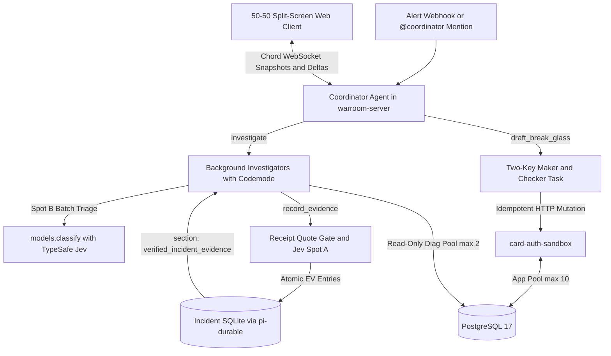

# War room architecture decisions

This document explains the architectural design for the Proof-of-Concept credit-card incident war room. For exact schemas, pools, role matrices, and tool contracts, read [Architecture reference](file:///home/nate/Projects/eng-soft-class/final-assigment/docs/architecture-reference.md). For background literature and primary benchmarks, read [War room protocols and state machine research](file:///home/nate/Projects/eng-soft-class/final-assigment/docs/research/war-room-protocols-and-state-machine.md) and [Jev and System One models research](file:///home/nate/Projects/eng-soft-class/final-assigment/docs/research/jev-and-system1-models.md).

## Why the runtime separates the war room from the payment service

An incident tool that runs inside the failing service dies with the service. The PoC runs three separate processes so the control plane survives outages in the target payment pipeline:

1. **PostgreSQL 17 container.** Stores real `card_holds` rows, `schema_migrations` records, and live lock and transaction state. Faking database contention with an in-memory map hides transaction isolation, lock waits, and multi-version concurrency behavior. Real PostgreSQL lets investigators inspect `pg_stat_activity` and run `EXPLAIN` against live queries while still booting in about one second via Docker Compose.
2. **`card-auth-sandbox` process.** Simulates Visa and Mastercard BIN routing and two external acquirer gateways over a bounded `pg.Pool` of 10 connections. Keeping the target in its own Node.js process forces every diagnostic check and every remediation call to cross real HTTP and SQL boundaries.
3. **`warroom-server` process.** Owns one SQLite file per incident through `@earendil-works/pi-durable@1.4.0` and serves multiplayer state deltas over `@earendil-works/chord@1.4.0` WebSockets. Killing and restarting `warroom-server` mid-incident loses no transcript entries, receipts, or approvals because every step commits to SQLite before execution continues.

All instructions, domain runbooks, and post-incident specs follow vendor-neutral open conventions: `AGENTS.md`, `skills/*/SKILL.md`, and `REMEDIATION_SPEC.md`.

## Why PostgreSQL uses three isolated connection pools

During the cascade decoy scenario, slow responses from `acquirer-beta` hold open transactions until `card-auth-sandbox` exhausts all 10 connections in its application pool. If diagnostic queries or remediation endpoints shared that pool, investigator queries would block indefinitely behind the stuck transactions.

Separating database access into three small pools solves both contention and visibility:

- **Application pool.** Uses 10 connections for live card authorization traffic.
- **Diagnostic pool.** Uses 2 read-only connections under a dedicated `warroom_diag` role with `pg_read_all_stats`, a 2-second statement timeout, and a 500-millisecond lock timeout. Investigators can inspect stuck `card-auth-sandbox` sessions even when application traffic is completely stalled.
- **Admin pool.** Uses 2 connections reserved for idempotent Break-Glass mutations and rollback checks.

The sandbox's own telemetry routes answer from an in-process window and the pool's live counters rather than from SQL. A query through the application pool would block exactly when that pool saturates, which is when investigators need the numbers.

PostgreSQL multi-version concurrency control also hides uncommitted `card_holds` rows from a plain `SELECT COUNT(*)` query on `status = 'PENDING'`. Checking both committed `PENDING` rows and `idle in transaction` sessions in `pg_stat_activity` prevents the rollback check from falsely reporting zero in-flight holds during an active stall.

## Why the war room pairs System 2 agents with Jev System One decisions

Asking one frontier chat model to parse hundreds of raw log records, filter prompt injections, curate shared memory, and reason across service hops wastes context tokens and slows down the bridge. Conversely, trusting fast pattern-matching models to declare root causes leads to availability bias, where the model blames the newest deploy or the loudest downstream timeout.

The architecture splits these jobs by cognitive type:

- **System 2 reasoning models own multi-hop investigation and planning.** The root Coordinator agent generates competing hypotheses on alert arrival and synthesizes findings. Background investigators run in isolated child conversations from a four-row `SPECIALISTS` configuration table covering logs, database state, deployments, and acquirers. One shared investigator task definition avoids maintaining four separate agent codebases while preserving isolated failure boundaries.
- **TypeSafe `Jev` owns bounded, single-pass classification.** `Jev` is a non-generative System One model queried through `@earendil-works/pi-ai` `models.classify()`. It reads structured state, evaluates typed `choice` or `score` rubrics in roughly 330 milliseconds median network latency, and emits zero output tokens. Because independent benchmarks in `arXiv:2609.37647` show that `Jev` `choice` distributions are well calibrated while naive `0.5` boolean thresholds are poorly centered, every war-room gate uses explicit multi-label `choice` criteria and fails closed when `stopReason` is not `"stop"`.

This split gives `Jev` three narrow responsibilities and keeps it out of root-cause authoring:

1. **Evidence gatekeeping in `record_evidence`.** Replacing a conversational Scribe LLM with deterministic receipt verification plus one `Jev` `choice` call prevents paraphrasing bugs and cuts multi-second write latency. Deterministic code confirms that the cited `receiptId` exists, that the quote matches the sanitized receipt text character for character, and that the observation hash is new. `Jev` then classifies whether the observation states an atomic measurement or sneaks in causal speculation.
2. **Parallel batch triage inside `Codemode`.** Investigators use `@earendil-works/pi-durable/codemode` to fan out `models.classify()` across batches of up to 50 failed authorizations or webhooks inside QuickJS. The script stores raw classifications with `store()` and returns only category counts and top anomalous trace IDs to the System 2 model. Because aggregate percentages do not appear verbatim in any single receipt, investigators fetch those top 1 to 3 traces directly afterward to obtain quotable `receiptId` records.
3. **Toggleable semantic prompt-injection screening.** Deterministic sanitization handles card PAN redaction, keyed CVV masking, and invisible Unicode tag stripping. Plain-English prompt injections hidden inside webhook bodies require semantic judgment. Placing a `Jev` `choice` classifier inside the shared fetch helper behind a UI toggle lets operators compare regex-only sanitization against System One semantic quarantine live during demonstrations, while preventing `Codemode` scripts from reading unscreened webhook text.

## Why shared memory uses receipts and dynamic prompt sections

When multiple subagents write free-form summaries into shared memory, early guesses harden into false facts. Restricting `app.warroom` evidence entries to receipt-backed atomic observations keeps the shared ledger clean.

Storing raw tool outputs inside the main `app.warroom` session document would bloat every WebSocket delta sent to connected browsers. Instead, the shared diagnostic fetch helper upserts sanitized tool payloads into a separate session-scoped `defineDocFamily` keyed by `receiptId`. Even when a tool runs inside `Codemode` where nested task documents disappear after script completion, the session-level receipt survives and remains verifiable.

Later investigators inherit both verified `EV-*` facts and ruled-out hypotheses through an append-only `pi-durable` prompt `section` named `verified_incident_evidence`. Append-only ordering keeps unchanged prompt prefixes identical across turns so provider prompt caches stay warm while eliminating duplicate queries.

Human chat uses a parallel optimization. Responder messages use `submit` with `type: "write"` so human-to-human coordination commits immediately without triggering an LLM run or waiting behind a busy Coordinator turn. Because passive writes without model messages are invisible to the LLM transcript by default, a second prompt `section` named `recent_bridge_chat` injects the latest 20 human messages whenever `@coordinator` is mentioned.

## Why agents hold zero mutating tools

Holding an in-memory promise inside a `beforeTool` hook while waiting for human approval breaks crash recovery. In `pi-durable`, `HookApi` is read-only and loses in-flight waits if the host restarts.

Giving agents zero mutating tools eliminates that failure mode and matches real incident command practice:

1. **Open investigation, gated mutation.** Both the Incident Commander and Responders can open hypotheses, dispatch investigators, steer active runs, and answer human-attested Bridge Questions. Neither humans nor agents can declare a hypothesis `confirmed` in state until its `missingEvidence` list is empty and at least one supporting `EV-*` record is linked.
2. **Cryptographic Maker and Checker separation.** The Coordinator only drafts Break-Glass proposals. A Responder signs Key 1 as Maker, recording a SHA-256 digest of the canonical action and arguments. A distinct user acting as Incident Commander signs Key 2 as Checker against that exact digest while the incident is in the `MITIGATE` phase.
3. **Durable idempotent execution.** The Key 2 commit atomically creates an `app.break-glass` durable task in SQLite. That task calls `card-auth-sandbox` over the admin pool with an `Idempotency-Key` stored via PostgreSQL `ON CONFLICT`, guaranteeing at-most-once mutation across process crashes.
