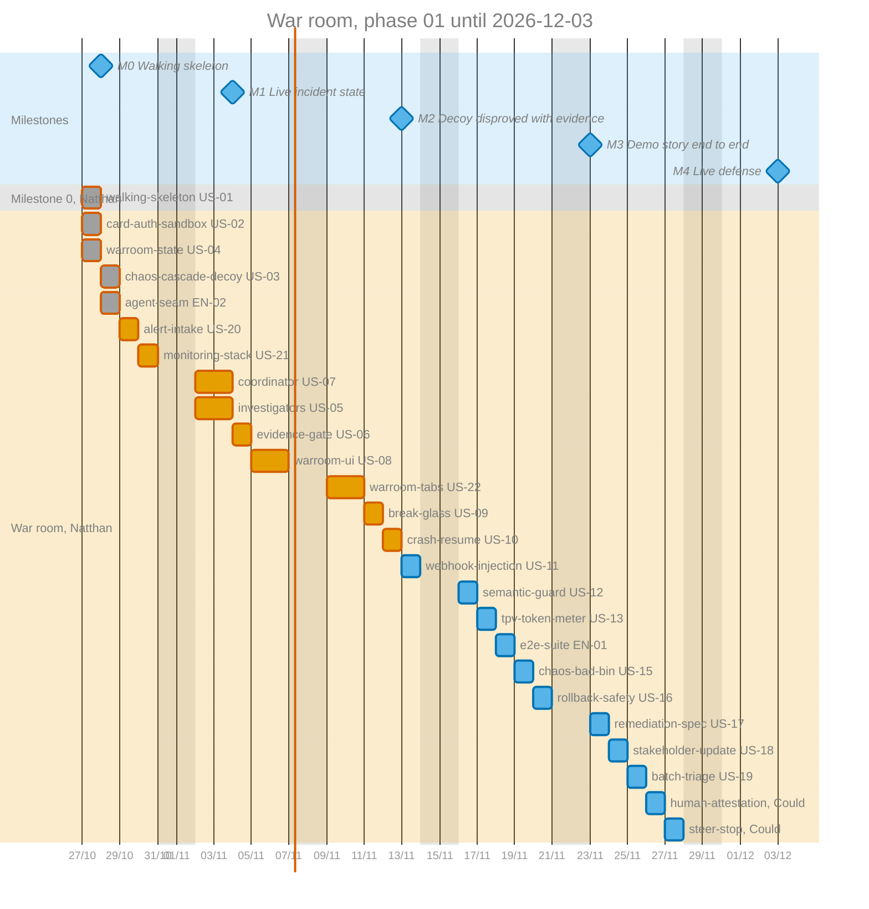

# War room roadmap

Last checkpoint: 2026-10-28. Stories: [STORIES.md](STORIES.md).

Phase 01, new project. Previous phases: None.

## Goal and demo story

During a Sev-1 card-payment outage, responders anchor on the loudest symptom and lose minutes to it. The war room runs AI investigators that may only record receipt-backed evidence, and it lets a remediation run only after two people sign it.

Demo story: Alice, the Incident Commander, and Bob, a Responder, open the war room in two browsers. The presenter starts the cascade decoy from a terminal: an 8-second `acquirer-beta` delay that saturates the sandbox's database pool. The company's Grafana dashboard shows authorizations slowing and the pool filling, and its alert rule calls the war room's webhook. The Coordinator wakes and opens competing hypotheses, and investigators record receipt-backed evidence that disproves the "database saturated" decoy and points at `acquirer-beta`. Midway through, someone runs `kill -9` on `warroom-server`, and the investigation resumes with nothing lost. The Coordinator drafts a Break-Glass action. Bob signs Key 1, and Alice signs Key 2. The sandbox recovers, and the card TPV bleed drops on screen.

## Constraints

- Output language: English.
- Deadline: 2026-12-03, the live defense. The date is fixed, and the cut line moves when time runs short.
- Developers: 1, Natthan.
- Must budget: at the 2026-10-28 checkpoint, the remaining Musts take 11 of the 25 working days left (44%), inside the 60% budget at the recalibrated pace. At the kickoff they did not fit at the standard pace.
- Quality bar: every screen is built as a finished, production-grade product, not a demo-only panel (D-10).

## Schedule

The chart spreads the scope features over the front in working days, up to the demo on 2026-12-03. Only the milestone dates are fixed. The feature dates are a proposal, and the team revises them at each checkpoint.

The schedule rests on these assumptions:

- Sizes become working days: S takes 1 day, M takes 1, and L takes 2 (D-11). The 2026-10-28 checkpoint measured about 7 planned days of features finished in 2 calendar days, so this mapping still holds about half the measured pace in reserve for review, integration, and UI polish.
- Finished features show their actual dates, one day each.
- The chart skips weekends. The team works every weekday, holidays included.
- `coordinator` and `investigators` run on the same days in two Git worktrees, both supervised by Natthan, and merge before `evidence-gate` (D-09). It is the one place the chart gives one developer two tasks on a day.
- The extras run in reverse cut order, so the last feature to cut is built first. Under this plan the Musts end on 2026-11-12, every Should ends by 2026-11-25, and both Coulds by 2026-11-27, four working days before the defense.
- No Must waits for a Could, so cutting `steer-stop` frees no Must date. It shortens the tail of the extras.
- One developer means little slack outside the parallel pair. A one-day slip in any Must moves every later bar by one day.

## Scope

| Priority | Feature | Slug | Size | Stories | Front |
| --- | --- | --- | --- | --- | --- |
| Must | Walking skeleton: compose stack, three PostgreSQL pools and roles, empty services, UI shell, test runner | `walking-skeleton` | M | US-01 | War room |
| Must | Card authorization sandbox with BIN routing, two acquirers, and read-only telemetry | `card-auth-sandbox` | M | US-02 | War room |
| Must | Groundwork: the Coordinator–investigator contract, agent registration, and incident document version 2 | `agent-seam` | S | EN-02 | War room |
| Must | Alert webhook that wakes the war room, plus the agent wiring both agent features need | `alert-intake` | M | US-20 | War room |
| Must | The company's monitoring stack: Grafana dashboards over Prometheus metrics and the payments database, and an alert rule that calls the war room | `monitoring-stack` | M | US-21 | War room |
| Must | Scenario A, the cascade decoy fault | `chaos-cascade-decoy` | S | US-03 | War room |
| Must | Incident state, phases, roster, and Chord role permissions | `warroom-state` | M | US-04 | War room |
| Must | Four specialist investigators with receipts and sanitization | `investigators` | L | US-05 | War room |
| Must | Evidence gate: receipt and quote checks, causal regex, and Jev Spot A | `evidence-gate` | M | US-06 | War room |
| Must | Coordinator agent with hypothesis tools and the confirmation gates | `coordinator` | M | US-07 | War room |
| Must | War room UI foundation: design system, split-screen layout, top bar, and the bridge chat | `warroom-ui` | L | US-08 | War room |
| Must | War room tabs: Hypotheses, Evidence, Break-Glass, and Status & Spec | `warroom-tabs` | L | US-22 | War room |
| Must | Two-Key Break-Glass with durable idempotent execution | `break-glass` | M | US-09 | War room |
| Must | Crash and resume of `warroom-server` during an investigation | `crash-resume` | S | US-10 | War room |
| Should | Overlay I, webhook prompt injection and PAN leak | `webhook-injection` | S | US-11 | War room |
| Should | Jev Spot C semantic injection guard toggle | `semantic-guard` | S | US-12 | War room |
| Should | Card TPV bleed versus agent token spend meter | `tpv-token-meter` | S | US-13 | War room |
| Should | Deterministic end-to-end suite for the demo scenarios | `e2e-suite` | M | EN-01 | War room |
| Should | Scenario B, the bad BIN config rollout | `chaos-bad-bin` | S | US-15 | War room |
| Should | Rollback Safety check | `rollback-safety` | M | US-16 | War room |
| Should | `REMEDIATION_SPEC.md` export in POSTMORTEM | `remediation-spec` | S | US-17 | War room |
| Should | Stakeholder Update publisher | `stakeholder-update` | S | US-18 | War room |
| Should | Jev Spot B batch triage inside Codemode | `batch-triage` | M | US-19 | War room |
| Could | Steer and Stop controls on running investigators | `steer-stop` | S | - | War room |
| Could | Human-attested answers to `missingEvidence` | `human-attestation` | S | - | War room |
| Won't | Conversation fork for parallel hypotheses | `conversation-fork` | - | - | - |
| Won't | `intent.md` generation | `intent-md` | - | - | - |
| Won't | Real authentication or SSO | `real-auth` | - | - | - |
| Won't | Real acquirer integrations | `real-acquirers` | - | - | - |
| Won't | Cloud deployment | `cloud-deploy` | - | - | - |

Cut order, first to go: `steer-stop`, `human-attestation`, `batch-triage`, `stakeholder-update`, `remediation-spec`, `rollback-safety`, `chaos-bad-bin`, `e2e-suite`, `tpv-token-meter`, `semantic-guard`, `webhook-injection`.

Shipped by 2026-10-28: `walking-skeleton`, `card-auth-sandbox`, `warroom-state`, `chaos-cascade-decoy`, and `agent-seam`, each verified.

At a phase close, the Priority column keeps the phase's priorities, and each row records whether the feature shipped.

## Milestones

| Milestone | Outcome | Target date | Status |
| --- | --- | --- | --- |
| 0 | Walking skeleton: `docker compose up` starts PostgreSQL, `card-auth-sandbox`, and `warroom-server`. A browser opens the war room shell over a Chord WebSocket, and the build and test commands run. | 2026-10-28 | Done 2026-10-27 |
| 1 | The presenter starts the cascade decoy and the sandbox pool saturates, while Alice and Bob see the same incident state live in two browsers, each with their own role permissions. | 2026-11-04 | Done 2026-10-28 |
| 2 | The Grafana alert wakes the war room and opens competing hypotheses. Investigators record receipt-backed evidence that disproves the database decoy, and the gate rejects speculative or unquoted evidence. | 2026-11-13 | Not started |
| 3 | The whole demo story runs in the finished split-screen UI: Two-Key Break-Glass fixes `acquirer-beta`, and a `kill -9` mid-investigation resumes cleanly. | 2026-11-23 | Not started |
| 4 | The demo story at the live defense, with the Shoulds that shipped. | 2026-12-03 | Not started |

## Fronts

### War room

- Owner: Natthan.
- Outcome: the whole demo story, built in sequence.
- Owns: the whole repository.
- Provides: None, because there is no other front to use them.
- Uses: None.
- Depends on: milestone 0.
- Stories: US-01 to US-13, US-15 to US-22, EN-01, and EN-02. US-14 became EN-01.
- Status: ahead of schedule. Milestones 0 and 1 are done; next is `alert-intake`. No blockers.

## Shared files

None between fronts: with one front, every file has the same owner. Milestone 0 created the shared structure, such as the compose file, the migration layout, and the service folders, so that each later feature adds files instead of editing shared ones.

Inside the front, `coordinator` and `investigators` are built at the same time in two worktrees (D-09). Constraint record `agent-seam-ownership` names the files each one owns and the seam files neither edits; `alert-intake` lands every change to those seam files before the two builds start.

## Contracts

None. Contracts in this roadmap are interfaces between fronts, and there is only one front. The interfaces between `card-auth-sandbox` and `warroom-server` live in [Architecture reference](../architecture-reference.md) and in each feature's plan.

## Risks and assumptions

- The Musts fill 20 of 27 working days at the AI-assisted pace, and need more than all 27 at the standard pace. If milestone 2 slips past 2026-11-13, cut in the agreed order at that checkpoint instead of waiting for the last week.
- `@earendil-works/pi-durable@1.4.0` and `@earendil-works/chord@1.4.0` are new releases. If an API in the architecture does not behave as documented, the walking skeleton finds out first, and the team changes the architecture before milestone 1.
- The live demo reaches both the reasoning model and Jev through one OpenRouter key. Every gate fails closed, so an OpenRouter outage, a rate limit, or an exhausted credit balance during the defense would stall the demo. Top up the credits before 2026-12-03, rehearse with the deterministic test providers, and keep a recorded run as a fallback.
- Model answers vary between runs. If the Coordinator wanders during rehearsals, tighten the `AGENTS.md` rules and the specialist skills before tightening the code.
- The defense machine must run Docker. Check it before 2026-12-03.
- The parallel `coordinator` and `investigators` builds merge into `main` before `evidence-gate`. If either needs a seam file changed mid-build, both stop for a joint decision, which can cost a day.
- Models run through OpenRouter with `anthropic/claude-haiku-5.5` for every agent until the team picks the final models (D-12). Rehearse the demo again after any model change.

## Out of scope

- Conversation fork: one shared bridge is enough for the demo story, and fork adds a second state to explain.
- `intent.md`: `REMEDIATION_SPEC.md` replaces it as the post-incident artifact.
- Real authentication or SSO: three seeded users show the Maker and Checker separation without an identity provider.
- Real acquirer integrations: the sandbox simulates `acquirer-alpha` and `acquirer-beta` so the faults can be reproduced.
- Cloud deployment: the grading asks for a one-command local startup with `docker compose`.

## Decisions

Decisions that cross fronts live in [DECISIONS.md](DECISIONS.md).
